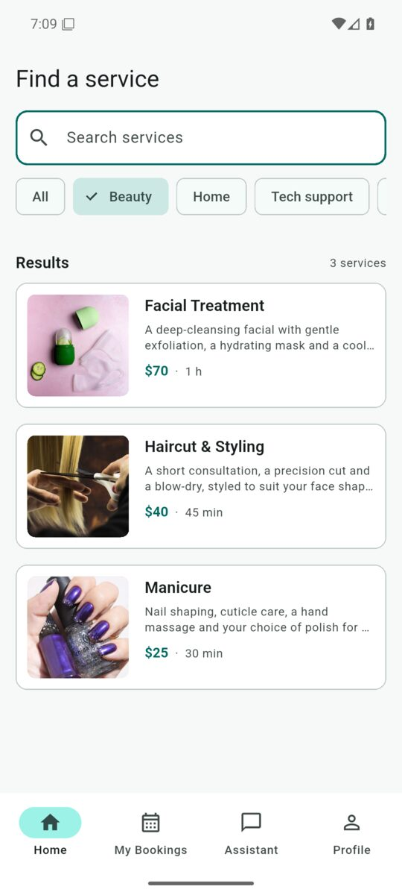
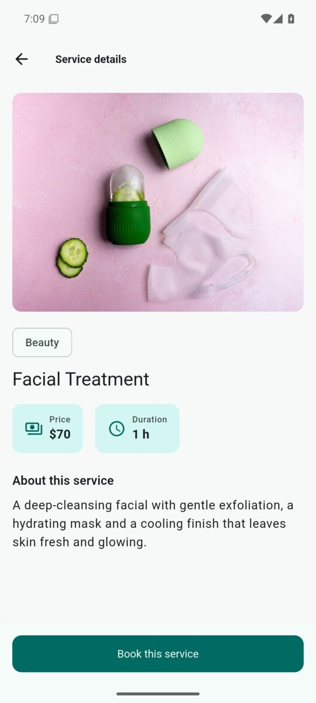

# Servora app

The Flutter client for Servora (Android application id `com.servora.app`).

Built with Flutter, Riverpod (state), go_router (navigation) and dio (HTTP). Screens depend
on providers, providers on repositories, and repositories on one API client.

## Prerequisites

- Flutter 3.50 or newer (`flutter --version`)
- Android SDK with an emulator or a physical Android device (`flutter doctor`)
- The backend running (see [../backend/README.md](../backend/README.md) or run
  `docker compose up --build` from the repository root)

## Setup and run

```bash
cd frontend
flutter pub get
flutter run                      # uses the emulator-friendly default API URL
```

## Pointing the app at the API

The API address is a build-time setting, passed with `--dart-define`. It is **not** a secret;
anything compiled into an app can be extracted, so never put keys here. (The AI provider key
lives only on the backend.)

| Where the app runs | `API_BASE_URL` | How |
|---|---|---|
| Android emulator | `http://10.0.2.2:3000` (the default) | `flutter run` |
| Physical device on the same Wi-Fi | `http://<your-computer-LAN-IP>:3000` | `flutter run --dart-define=API_BASE_URL=http://192.168.1.20:3000` |
| Hosted backend | `https://<your-host>` | `flutter build apk --release --dart-define=API_BASE_URL=https://<your-host>` |

Why `10.0.2.2`: inside the Android emulator, `localhost` is the emulator itself. Android maps
the special address `10.0.2.2` to your computer, where the backend listens on port 3000.

For a physical device, find your computer's LAN address (for example `hostname -I`) and make
sure the phone is on the same network and no firewall blocks port 3000.

### Check the API is reachable first

A tiny script uses the app's own HTTP client to call `/health`, so you can test an address
before running the app:

```bash
dart run tool/check_api.dart                          # default: http://10.0.2.2:3000
dart run tool/check_api.dart http://192.168.1.20:3000
```

(`10.0.2.2` only resolves inside the Android emulator, so on your computer use `localhost`
or the LAN address.)

## How sign-in works

- **One source of truth.** `core/session/` owns who is signed in (`SessionNotifier`: unknown,
  authenticated, or unauthenticated). The router redirect and the API client both read it, so
  they can never disagree.
- **Persistent session.** After login or registration the token, its expiry and the user are saved
  with `flutter_secure_storage` (Android Keystore-backed), never in plain preferences. On launch the
  app reads them, shows a splash screen briefly, then goes straight to Home, or to the sign-in
  screen if nothing valid is saved.
- **Expiry.** A saved token that has expired is deleted on launch and the sign-in screen explains
  "Your session has expired". If the server rejects a token that a request carried (HTTP 401) the
  session is cleared and the user is returned to sign-in with the same message. A *failed login*
  (wrong password) never signs anyone out: it carries no token.
- **Logout** removes the token and cached user from the device and replaces the navigation stack,
  so Back cannot return to a signed-in screen.
- **Forms** validate with the same rules and wording as the API (`AuthValidators`), show server
  messages on the right field (for example "An account with this email already exists" under
  Email), block double submits, and keep what was typed when a request fails or the device is
  offline.
- **No refresh token** (see the trade-off in [../backend/README.md](../backend/README.md)): a token
  lasts 7 days, and the user simply signs in again after that.

## Browsing services

- **Home tab.** A search box, category chips, a highlighted **Featured** row and the full list.
  Typing in the search box waits for a short pause (about 350 ms) before asking the API, so fast
  typing sends one request, not one per letter. Choosing a category applies at once; choosing it
  again clears it. The Featured row is hidden while a search or category is active.
- **The filter survives tab switches and the detail screen.** It lives in a provider, not in the
  screen, so coming back to Home shows the same search, category, results and scroll position.
- **While a new search loads**, the previous results stay on screen under a thin progress bar
  instead of flashing empty. If an older request finishes after a newer one, its result is ignored.
- **Loading, empty and error states.** Grey card-shaped placeholders on the first load; "No
  services found" with a **Clear filters** button when nothing matches; a readable message with
  **Try again** when a request fails. A failing Featured row never hides the list, and the other
  way round. Pull down to refresh everything. Longer lists load the next page when you scroll
  near the end.
- **Pictures** are kept on disk by `cached_network_image`. Each picture has a fixed 4:3 (or
  square) box, so nothing moves while it loads, and a neutral placeholder takes its place if the
  service has no picture or it fails to load.
- **Layout.** One column on phones, two or three on tablets and wide screens; verified with
  text enlarged to 3x on a 320 dp screen.
- **Service detail.** Tapping a service opens its page at once from the list copy, then quietly
  refreshes it from the API. A **Book this service** bar stays on screen while the page scrolls.
  If the service has been removed since, the page says so instead of letting you book it.

### Screenshots

Captured from the app running on an Android emulator against the real API with the seeded
catalogue.

| Home | Search | Category | Service detail |
|---|---|---|---|
|  |  |  |  |

The photographs are used under their original licences; see
[../backend/public/images/services/ATTRIBUTION.md](../backend/public/images/services/ATTRIBUTION.md).

### Pictures and the Android emulator

The API reports each picture as an absolute URL built from **its** `PUBLIC_BASE_URL`. That address
must be reachable from the device, and inside the emulator `localhost` is the emulator itself. So
when you run the API for the emulator, start it with the emulator's alias for your computer:

```bash
PUBLIC_BASE_URL=http://10.0.2.2:3000 docker compose up -d --wait     # from the repository root
```

For a physical phone use your computer's LAN address instead (for example
`http://192.168.1.20:3000`); for a hosted API use its public `https://` address. If pictures show
the placeholder icon while the data loads fine, this is almost always the cause.

## Tests and checks

```bash
flutter analyze
flutter test
```

## Build the APK

With the Android SDK installed:

```bash
flutter build apk --release --dart-define=API_BASE_URL=https://<your-host>
# -> build/app/outputs/flutter-apk/app-release.apk
```

The first build downloads Gradle and the Android dependencies and can take a long time; later
builds are much faster. Install the APK on a device or emulator with
`adb install -r build/app/outputs/flutter-apk/app-release.apk`.

## Project layout

```
lib/
  main.dart  app.dart
  core/
    config/    AppConfig (API_BASE_URL)
    network/   dio client, envelope parsing, failure mapping
    session/   who is signed in: session state, secure token store
    format/    price and duration formatting
    error/     AppFailure: the one error type the UI sees
    router/    go_router, bottom-navigation shell, auth redirect
    theme/     colours, spacing, ThemeData
    layout/    responsive helpers
    widgets/   shared buttons, fields, cards, status badge, loading/empty/error views
  features/    one folder per feature: data/ domain/ presentation/
    auth/      login and registration
    services/  Home (search, chips, featured, list) and the service detail screen
    booking/   a placeholder screen until the booking flow is built
test/
tool/          small developer scripts
```
